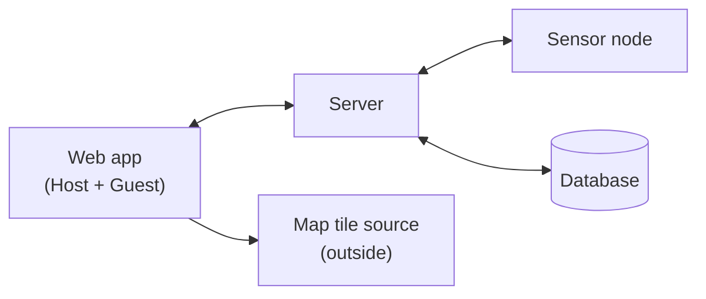

# System Components

**Project:** Vehicle Lane Counter System

## 1. Overview

The system has four parts and one outside service:

- **Sensor node** counts vehicles in a lane.
- **Server** holds the rules and connects everything.
- **Database** keeps all data.
- **Web app** is what Hosts and Guests see in a browser.
- **Map tile source** (outside service) provides the map images.

A component is a separate thing that runs on its own: a device, a program, or an outside service. Logic inside one of these is not a component.

## 2. Components

| Component | Runs on | Responsibility | Talks to |
| --- | --- | --- | --- |
| Sensor node | Battery-powered device in the lane | Detects each vehicle and records direction, speed, and type. Keeps counting while offline. Opens and keeps a connection to the server, and answers each server request over it with its stored events and battery level, or just that it is alive if it has no events. | Server |
| Server | Backend | Requests data from each sensor on a fixed interval, over the connection the sensor opened. Applies all rules (pools, alerts, access). Answers the web app. | Sensor node, Database, Web app |
| Database | Backend | Keeps all data indefinitely, including for removed sensors and pools. | Server |
| Web app | User's browser | One app for both users. Hosts sign in to manage everything. Guests view shared data without an account. Shows the map. | Server, Map tile source |
| Map tile source | Outside service | Supplies the map images the web app draws on. | Web app |

### 2.1 Sensor node parts

Physical parts of the sensor node, not separate components.

| Part | Responsibility |
| --- | --- |
| Vehicle detectors (2 magnetometers) | Sense the magnetic change when a vehicle passes. Two are spaced apart along the lane: which one triggers first gives direction, and the time between them gives speed. |
| Controller (Pico W) | Turns detector readings into vehicle events, stores them, and returns them when the server asks, over WiFi. |
| Battery | Powers the node. |
| Enclosure (PETG) | Protects the parts from vehicle weight, water, and dirt. Non-magnetic, so the detectors can sense vehicles through it. |

### 2.2 Server modules

Parts of the server program, not separate components.

| Module | Responsibility | FRs |
| --- | --- | --- |
| Ingestion | Requests data from each sensor on a fixed interval. Receives batches of vehicle events and battery level, or an alive reply. No reply means the sensor is offline. Records online/offline status, battery level, and offline gaps. | FR-03, FR-04, FR-05 |
| Accounts and access | Host sign-in. Each Host sees only their own data. | FR-01 |
| Sensor and pool management | Host labels, renames, configures, removes, or disregards sensors. Host sets up pools: sensors and their roles, capacity, map location, reset. Keeps each pool's live count and inaccuracy flag. A sensor belongs to at most one pool. | FR-02, FR-06 to FR-10, FR-21 |
| History and export | Past data queries, breakdowns, per-vehicle lists, export. | FR-12 to FR-14 |
| Alerts | System and threshold alerts. | FR-18, FR-19 |
| Guest sharing | What each Host shares, and serving it to Guests. | FR-16, FR-17, FR-22 |
| Live updates | Sends changes from ingestion, sensor and pool management, and alerts to open Host and Guest views, each seeing only what it is allowed to. | FR-08, FR-11, FR-17, FR-21, FR-22 |

### 2.3 Database tables

Major tables in the database, not separate components.

| Table | Holds | FRs |
| --- | --- | --- |
| accounts | Hosts and their settings. | FR-01 |
| sensors | Each sensor device, its label, and status. | FR-02 |
| vehicle_events | Every detected vehicle. | FR-03, FR-12 to FR-14 |
| pools | Each pool, its capacity, and map location. | FR-06, FR-21 |
| pool_sensors | Which pool each sensor belongs to, and its role over time. A sensor belongs to at most one pool. | FR-06, FR-07 |

## 3. Diagram

## 4. Requirement coverage

| FR | Components |
| --- | --- |
| FR-01 Host sign-in | Web app, Server (accounts) |
| FR-02 Sensor management | Web app, Server (sensor and pool management), Database |
| FR-03 Vehicle detection | Sensor node, Server (ingestion), Database |
| FR-04 Offline counting | Sensor node, Server (ingestion) |
| FR-05 Offline gaps | Server (ingestion, history), Database, Web app |
| FR-06 Pool setup | Web app, Server (sensor and pool management), Database |
| FR-07 Role change | Server (sensor and pool management), Database |
| FR-08 Live availability | Server (sensor and pool management, live updates), Web app |
| FR-09 Pool reset | Web app, Server (sensor and pool management) |
| FR-10 Pools with offline sensors | Server (sensor and pool management, ingestion), Web app |
| FR-11 Host dashboard | Web app, Server (live updates) |
| FR-12 Historical queries | Web app, Server (history), Database |
| FR-13 Per-vehicle history | Web app, Server (history), Database |
| FR-14 Export | Web app, Server (history) |
| FR-15 Data retention | Database |
| FR-16 Guest sharing | Web app, Server (sharing, accounts) |
| FR-17 Guest view | Web app, Server (sharing, live updates) |
| FR-18 System alerts | Sensor node, Server (ingestion, alerts, live updates), Web app |
| FR-19 Threshold alerts | Server (alerts, sensor and pool management, live updates), Web app |
| FR-20 Time zone | Web app |
| FR-21 Host map | Web app, Map tile source, Server (sensor and pool management, live updates) |
| FR-22 Guest map | Web app, Map tile source, Server (sharing, sensor and pool management, live updates) |
