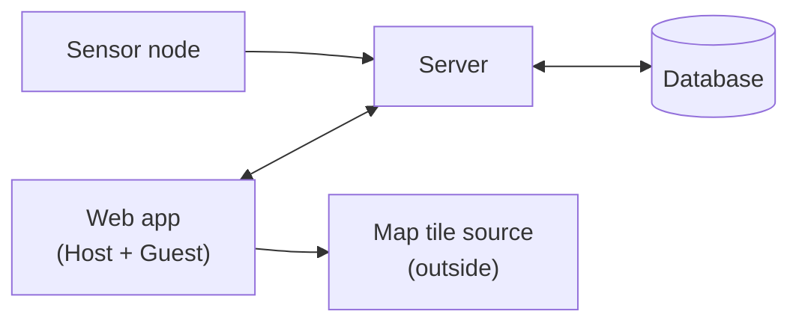

# System Components

**Project:** Vehicle Lane Counter System

## 1. Overview

The system has four parts and one outside service:

- **Sensor node** counts vehicles in a lane.
- **Server** holds the rules and connects everything.
- **Database** keeps all data.
- **Web app** is what Hosts and Guests see in a browser.
- **Map tile source** (outside service) provides the map images.

A component is a separate thing that runs on its own: a device, a program, or an outside service. Logic inside one of these is not a component.

## 2. Components

| Component | Runs on | Responsibility | Talks to |
| --- | --- | --- | --- |
| Sensor node | Battery-powered device in the lane | Detects each vehicle and records direction, speed, and type. Keeps counting while offline and sends the counts later. Reports battery level. | Server |
| Server | Backend | Receives sensor data. Applies all rules (pools, alerts, access). Answers the web app. | Sensor node, Database, Web app |
| Database | Backend | Keeps all data indefinitely, including for removed sensors and pools. | Server |
| Web app | User's browser | One app for both users. Hosts sign in to manage everything. Guests view shared data without an account. Shows the map. | Server, Map tile source |
| Map tile source | Outside service | Supplies the map images the web app draws on. | Web app |

### 2.1 Sensor node parts

Physical parts of the sensor node, not separate components.

| Part | Responsibility |
| --- | --- |
| Vehicle detectors (2 magnetometers) | Sense the magnetic change when a vehicle passes. Two are spaced apart along the lane: which one triggers first gives direction, and the time between them gives speed. |
| Controller (Pico W) | Turns detector readings into vehicle events, stores them, and sends them to the server over WiFi. |
| Battery | Powers the node. |
| Enclosure (PETG) | Protects the parts from vehicle weight, water, and dirt. Non-magnetic, so the detectors can sense vehicles through it. |

### 2.2 Server modules

Parts of the server program, not separate components.

| Module | Responsibility | FRs |
| --- | --- | --- |
| Ingestion | Accepts data from sensors. | FR-03, FR-04 |
| Accounts and access | Host sign-in and access control. | FR-01, FR-16 |
| Sensors | Labels, settings, removal, disregard, online/offline status, offline gaps. | FR-02, FR-05 |
| Pools | Pool setup, roles, capacity, live count, reset, inaccuracy flag, map location. | FR-06 to FR-10, FR-21 |
| History and export | Past data queries, breakdowns, per-vehicle lists, export. | FR-12 to FR-14 |
| Alerts | System and threshold alerts. | FR-18, FR-19 |
| Guest sharing | What each Host shares, and serving it to Guests. | FR-16, FR-17, FR-22 |

## 3. Diagram

## 4. Requirement coverage

| FR | Components |
| --- | --- |
| FR-01 Host sign-in | Web app, Server (accounts) |
| FR-02 Sensor management | Web app, Server (sensors), Database |
| FR-03 Vehicle detection | Sensor node, Server (ingestion), Database |
| FR-04 Offline counting | Sensor node, Server (ingestion) |
| FR-05 Offline gaps | Server (sensors), Database, Web app |
| FR-06 Pool setup | Web app, Server (pools), Database |
| FR-07 Role change | Server (pools), Database |
| FR-08 Live availability | Server (pools), Web app |
| FR-09 Pool reset | Web app, Server (pools) |
| FR-10 Pools with offline sensors | Server (pools, sensors), Web app |
| FR-11 Host dashboard | Web app, Server |
| FR-12 Historical queries | Web app, Server (history), Database |
| FR-13 Per-vehicle history | Web app, Server (history), Database |
| FR-14 Export | Web app, Server (history) |
| FR-15 Data retention | Database |
| FR-16 Guest sharing | Web app, Server (sharing, accounts) |
| FR-17 Guest view | Web app, Server (sharing) |
| FR-18 System alerts | Sensor node, Server (alerts), Web app |
| FR-19 Threshold alerts | Server (alerts, pools), Web app |
| FR-20 Time zone | Web app |
| FR-21 Host map | Web app, Map tile source, Server (pools) |
| FR-22 Guest map | Web app, Map tile source, Server (sharing, pools) |
