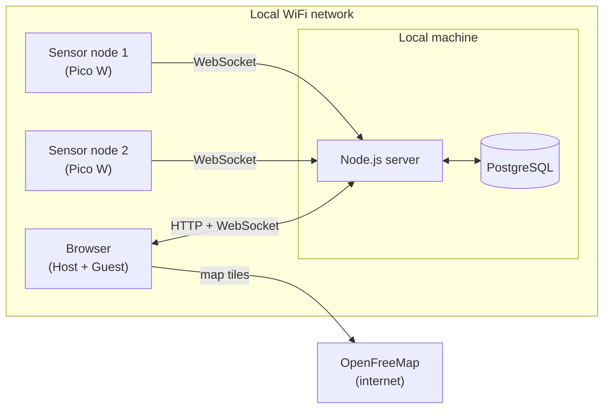
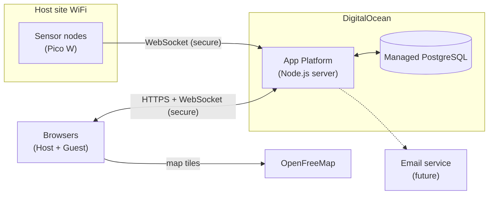

# Tech Stack and Deployment

**Project:** Vehicle Lane Counter System

## 1. Stack

| Layer | Choice | Why |
| --- | --- | --- |
| Sensor controller | Raspberry Pi Pico W | Built-in WiFi, low cost, low power. Reads battery level through its built-in analog input, so no extra hardware. |
| Vehicle detectors | 2x GY-271 (QMC5883L magnetometer) | Low cost, 3-axis. Sense vehicles through the enclosure without touching them. Two give direction and speed. |
| Battery | 3.7V LiPo, 3000mAh, rechargeable | Within the Pico W's supported input range. Rechargeable, so the node can be reused without replacing cells. |
| Enclosure | PETG | Strong and weather resistant. Non-magnetic, so the detectors work through it. |
| Sensor firmware | MicroPython | Faster to write and change than C. The official MicroPython libraries include a WebSocket client. |
| Sensor-to-server protocol | WebSocket | The sensor opens the connection, so it works behind the Host's router. The server can then send requests over it at any time. No extra service needed. |
| Backend | Node.js, one server program | Same language as the frontend. Strong WebSocket support. One program is enough for the MVP. |
| Database | PostgreSQL | Data is relational (accounts, sensors, pools, events). Handles time-window queries well. Offered as a managed service on the final host. |
| Frontend | React | One app for Host and Guest views. Widely known, large set of libraries. |
| Map library | MapLibre | Free and open source. Draws vector map tiles in the browser. |

## 2. Hosting

| Stage | Where | Notes |
| --- | --- | --- |
| MVP | Local machine on the same network as the sensors | No cost. Sensors and server share one WiFi network. |
| Final | DigitalOcean App Platform, with DigitalOcean Managed PostgreSQL | Runs Node.js directly from the repo. Supports WebSockets over HTTPS. Managed database handles backups. |

## 3. External Services

| Service | Choice | Why |
| --- | --- | --- |
| Map tiles | OpenFreeMap | Free, no API key, no usage limits. Works with MapLibre. |
| Alert delivery (ISS-03) | In-app only for MVP. Email service later, provider TBD. | No outside service needed for MVP. Email reaches the Host when the app is closed. |

## 4. Deployment Diagram

### 4.1 MVP

### 4.2 Final

Arrows point from the side that opens the connection.
